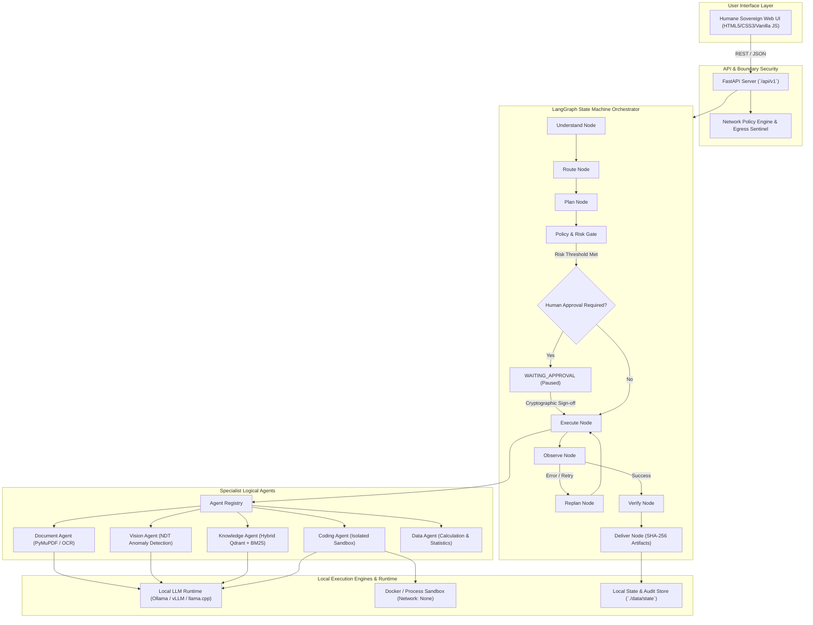

# Sovereign On-Premise Agentic AI Workbench

**Zero-Egress, Self-Hosted Multimodal AI Workbench for Enterprise Confidential & Industrial Knowledge Work**

[](https://www.python.org/)
[](#security--sovereignty-guarantees)
[](#testing--verification)

---

## 1. Project Overview

The **Sovereign On-Premise Agentic AI Workbench** is a specialized, model-agnostic, zero-egress agentic system built to operate entirely within an organization's air-gapped or private on-premise infrastructure.

Unlike conventional cloud-tethered agent frameworks, this workbench guarantees that:
> **No data, prompt, document, telemetry, or model inference ever leaves the organization's controlled environment.**

### Core Operational Principles
- **Air-Gapped & Sovereign**: Permanent local-only network boundary. Outbound requests to cloud LLM APIs, tracking servers, or telemetry collectors are rejected by fail-closed network policies.
- **Capability-Based Model Routing**: Agents declare required capabilities (e.g. `visual_reasoning`, `code_execution`, `calculation`) rather than hard-coding model identifiers. The runtime dynamically maps requests to available local open-weight models (e.g. Qwen2.5/Qwen3, Qwen2.5-VL/Qwen3-VL, Qwen2.5-Coder).
- **Deterministic Approval Gates**: High-risk operations (such as code execution in sandboxes or access to restricted documents) deterministically pause the LangGraph state machine with cryptographic plan hashing until an authorized human engineer approves.
- **Multimodal Evidence Normalization**: Scanned engineering drawings, technical PDFs, and photos are ingested through a unified multimodal pipeline extracting OCR text, table structures, and candidate visual defect observations.
- **Verified Deliverables**: Tasks yield verifiable artifacts (`.docx`, `.xlsx`, `.md`) accompanied by cryptographic SHA-256 hashes, citation provenance, and execution traces rather than unverified chat responses.

---

## 2. Architecture

The workbench coordinates task execution through a compiled LangGraph state machine executing the deterministic lifecycle:
$$\text{UNDERSTAND} \longrightarrow \text{ROUTE} \longrightarrow \text{PLAN} \longrightarrow \text{POLICY} \longrightarrow \text{APPROVE} \longrightarrow \text{EXECUTE} \longrightarrow \text{OBSERVE / REPLAN} \longrightarrow \text{VERIFY} \longrightarrow \text{DELIVER}$$



---

## 3. Specialist Logical Agents

| Agent ID | Capabilities | Tools & Technologies | Security Risk Class |
|---|---|---|---|
| `main_agent` | Task intake, aggregation, delivery | LangGraph StateGraph, Artifact Factory | `LOW` |
| `reasoning_agent` | Decomposition, planning, replanning | Structured reasoning, Local LLM | `LOW` |
| `document_agent` | PDF/DOCX ingestion, text extraction, layout analysis | PyMuPDF, OCR Engine, Prompt Defense | `LOW` |
| `vision_agent` | Visual observation, engineering drawings, candidate indications | Vision-Language Models (Qwen2.5-VL), Region Detector | `MEDIUM` |
| `knowledge_agent` | Sovereign hybrid search, grounded generation, citation checking | Qdrant Vector Store, BM25 Lexical Index, RRF | `LOW` |
| `coding_agent` | Script generation, static safety analysis, sandbox execution | Isolated Docker/Subprocess Sandbox (`network=none`) | `HIGH` (Requires Approval) |
| `data_agent` | CSV/XLSX analysis, formula evaluation, calculation traces | Pandas, NumPy, Deterministic Arithmetic Verifier | `LOW` |

---

## 4. Repository Directory Structure

```text
Soveriegn-AI-WorkBench/
├── .env.example                 # Baseline environment configuration template
├── Dockerfile.sandbox           # Dockerfile for isolated sandbox execution container
├── pytest.ini                   # Pytest test suite configuration
├── requirements.txt             # Production and development dependencies
├── README.md                    # Project documentation
├── ARCHITECTURE.md              # Detailed architecture specifications
├── SECURITY.md                  # Zero-egress security policy & audit framework
├── backend/
│   └── app/
│       ├── agents/              # Agent registry and Agent-to-Agent (A2A) messaging
│       ├── api/                 # FastAPI REST API routes, models, and controllers
│       │   ├── server.py        # API server and request routing
│       │   └── static/          # Single-Page Web Interface (HTML5/CSS3/JS)
│       ├── artifacts/           # Deliverable generation (.docx, .xlsx, markdown)
│       ├── coding/              # Coding agent logic, code generation, and tools
│       ├── config/              # Central Pydantic BaseSettings configuration
│       ├── data/                # Data agent, CSV parser, and arithmetic verifier
│       ├── models/              # Local OpenAI-compatible runtime, hardware probe, registry
│       ├── multimodal/          # PDF processing, OCR, layout extraction, prompt defense
│       ├── orchestration/       # LangGraph StateGraph, nodes, edges, planner, routing
│       ├── rag/                 # Knowledge agent, Qdrant store, BM25 index, grounded generator
│       ├── sandbox/             # Docker and local subprocess sandboxes, resource limiters
│       ├── schemas/             # Pydantic schemas for agents, tools, and models
│       ├── security/            # Sovereignty policy, Egress Sentinel, approval gates
│       ├── state/               # Persistent task state store and append-only event logs
│       ├── tools/               # Tool registry and execution wrappers
│       └── vision/              # Engineering vision agent, defect inspector, verifier
├── configs/
│   ├── models.small.yaml        # Small profile model definitions (4B - 7B class)
│   ├── models.high.yaml         # High profile model definitions (30B+ class)
│   └── policies.yaml            # Risk thresholds and approval rules
├── scripts/
│   └── test_complete_system.py  # 10-subsystem end-to-end verification script
└── tests/                       # 450+ unit, integration, and acceptance tests
    ├── acceptance/              # Phase acceptance test suites
    ├── fixtures/                # Synthetic test documents, sensor data, and images
    └── integration/             # Live local model and server integration tests
```

---

## 5. Prerequisites & Local Setup

### System Prerequisites
- **Python**: 3.11, 3.12, 3.13, or 3.14.
- **Hardware**: Compatible with local CPU inference or local GPU acceleration (NVIDIA RTX / CUDA supported).
- **Local Model Provider** (Optional for full live inference):
  - [Ollama](https://ollama.ai/) running locally (`http://127.0.0.1:11434`), or
  - [vLLM](https://github.com/vllm-project/vllm) / Local OpenAI-compatible endpoint (`http://127.0.0.1:8000/v1`).
- **Docker** (Optional): For containerized code execution sandboxes. If Docker is not installed, the workbench automatically falls back to an isolated local subprocess sandbox with environment scrubbing and timeouts.

### 1. Installation
Clone the repository and set up a Python virtual environment:

```bash
# Clone the repository
git clone https://github.com/sanat-commits/MY_PROJECT3.git
cd MY_PROJECT3

# Create and activate a virtual environment
python -m venv .venv

# On Windows:
.venv\Scripts\activate
# On Linux/macOS:
source .venv/bin/activate

# Install dependencies
pip install -r requirements.txt
```

### 2. Environment Configuration
Copy the configuration template:

```bash
cp .env.example .env
```

Key configuration options in `.env`:

```env
# Profile switch: false = small local profile, true = high-capacity local profile
USE_HIGH_LEVEL_MODELS=false

# Air-gapped sovereignty switches (Must remain local)
SOVEREIGN_MODE=true
ALLOW_EXTERNAL_NETWORK=false
ALLOW_CLOUD_MODELS=false
ALLOW_REMOTE_TELEMETRY=false

# Local LLM endpoint
MODEL_RUNTIME=vllm
MODEL_BASE_URL=http://127.0.0.1:11434/v1
MODEL_API_KEY=local-only

# Storage paths
DATA_ROOT=./data
```

---

## 6. Running the Workbench

### Start the Backend & Web Interface
Launch the FastAPI server using Uvicorn:

```bash
python -m uvicorn backend.app.api.server:app --host 127.0.0.1 --port 8000 --reload
```

Open your browser to access the single-page interface:
```text
http://127.0.0.1:8000/
```

### Pull Recommended Local Models (Ollama)
If using Ollama, pull lightweight open-weight models matching the active profile:

```bash
# General Reasoning & Knowledge
ollama pull qwen2.5:3b

# Vision & Multimodal Extraction
ollama pull qwen2.5vl:3b

# Code Generation
ollama pull qwen2.5-coder:3b
```

---

## 7. Testing & Verification

The codebase includes comprehensive unit tests, acceptance tests, and an end-to-end 10-subsystem verification suite.

### 1. Run the Pytest Test Suite
Executes unit tests and offline integration suites:

```bash
pytest
```
*Expected result: 451+ passed, 0 failures.*

### 2. Run the Complete System Verification Script
Executes end-to-end tests across all 10 core subsystems (sovereignty, model runtime, agent registry, multimodal pipeline, engineering vision, confidential RAG, coding sandbox, data agent, LangGraph approval gate, and live REST endpoints):

```bash
python scripts/test_complete_system.py
```
*Expected result: 30/30 capabilities passed with 100% operational status.*

### 3. Run Acceptance Gates
Executes the milestone acceptance verification suites:

```bash
pytest tests/acceptance/
```
*Expected result: 148/148 acceptance tests passed.*

---

## 8. REST API Reference

| Endpoint | Method | Description |
|---|---|---|
| `/` | `GET` | Serves the single-page web interface. |
| `/api/v1/sovereignty/status` | `GET` | Central zero-egress status, active local runtime endpoint, sandbox status. |
| `/api/v1/models` | `GET` | Probed local GPU/CPU hardware, VRAM usage, and loaded local model inventory. |
| `/api/v1/upload` | `POST` | Uploads engineering files, PDFs, images, or CSV datasets for task processing. |
| `/api/v1/tasks` | `POST` | Submits a task to the LangGraph orchestrator (`instruction`, `data_sensitivity`, etc.). |
| `/api/v1/tasks` | `GET` | Lists previous task executions, statuses, and deliverable metadata. |
| `/api/v1/tasks/{task_id}` | `GET` | Retrieves detailed state, execution steps, and plan for a specific task. |
| `/api/v1/tasks/{task_id}/events` | `GET` | Retrieves chronological immutable audit trail events for a task. |
| `/api/v1/tasks/{task_id}/approval` | `POST` | Submits human sign-off (`APPROVED` / `REJECTED`) to resume a paused task. |
| `/api/v1/artifacts/{file_name}/download` | `GET` | Downloads generated and verified deliverable files (`.docx`, `.xlsx`, `.md`). |
| `/api/v1/audit/logs` | `GET` | Global chronological audit events and network egress sentinel records. |
| `/api/v1/demos/{demo_id}` | `POST` | Executes pre-configured test scenarios (Demo 1 to Demo 5). |

---

## 9. Security & Sovereignty Guarantees

1. **Zero-Egress Enforcement**: All HTTP client requests in the application use `SovereignHttpClient` which validates destination hostnames and IP addresses against a strict local allowlist (`localhost`, `127.0.0.1`, `::1`). HTTP 3xx redirects to external endpoints and ambient environment proxies are intercepted and rejected with `SovereigntyViolationError`.
2. **Path Traversal Protection**: File upload handlers and artifact download endpoints canonicalize paths and verify directory containment within authorized `DATA_ROOT` folders.
3. **Sandbox Isolation**:
   - Docker Sandbox: Containers execute with `--network=none`, CPU quotas, memory limits, and a read-only root filesystem.
   - Local Process Sandbox: Cleanses host environment variables (preventing ambient credential leakage), restricts execution time, and isolates the working directory.
4. **Data Sensitivity Classifications**: Tasks are tagged with sensitivity levels (`PUBLIC`, `INTERNAL`, `CONFIDENTIAL`, `RESTRICTED`). The Knowledge Agent rejects retrieval requests where the document sensitivity exceeds the task clearance level.
5. **Human-in-the-Loop Integrity**: Plan hashes are cryptographically computed (SHA-256) at the time approval is requested. Resumption requires matching approval tokens to ensure no unauthorized plan alterations occur during pauses.

---

## 10. Limitations & Technical Debt

- **External Model APIs**: Commercial cloud model APIs (OpenAI, Anthropic, Google Vertex AI) are intentionally blocked and unsupported in sovereign mode.
- **Docker Dependency**: High-isolation container sandboxing requires a local Docker daemon. When unavailable, the system safely falls back to local subprocess isolation.
- **VLM Context Windows**: Processing large multi-page engineering drawings at high resolutions on local consumer GPUs (e.g. 6GB VRAM) requires tiling or thumbnail downsampling provided by the vision preprocessor.
